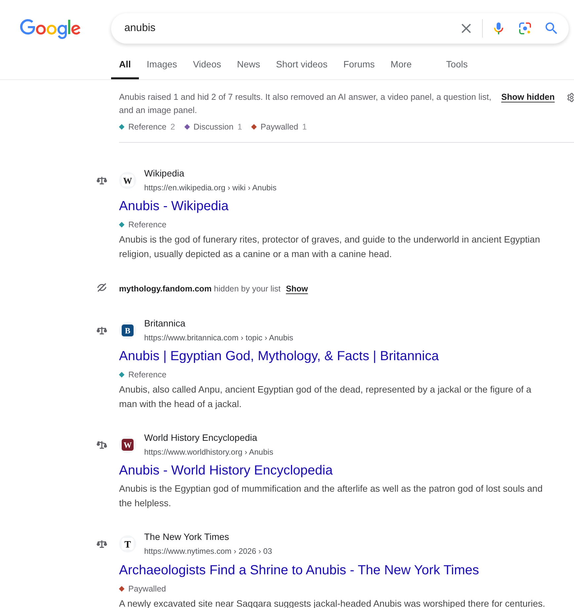

# Anubis style guide

How Anubis looks and reads on every surface it has: the popup, settings, the welcome page, and the tags, summary, and result menu it adds to search pages. Follow it for any change to the interface.

- `CLAUDE.md` and `CONTRIBUTING.md` give the short version of these rules.
- [`ACCESSIBILITY.md`](ACCESSIBILITY.md) covers the keyboard and screen readers. This guide only repeats what's visual (contrast, sizes, the focus ring).
- `docs/experiments.md` records why things are the way they are, including what was tried and dropped.

The screenshots below come from the wiki (`docs/img/`, regenerated with `node e2e/run.mjs docs`), so they show the current build. When an interface change affects one, regenerate the affected light and dark screenshots and update their nearby descriptions together; don't include unrelated generated files.

## Principles

1. **Quiet on someone else's page.** On a search page Anubis is a guest. It uses the page's own font, muted text, hairlines, and no fills. It never moves, restyles, or covers the engine's content.
2. **One flourish.** The result menu's balance is the only decoration. The popup shows it for the site you're on too, since it does the same job there. The Anubis motif stays in the logo and the balance; it never names a function.
3. **Plain words over clever ones.** A label says what happens. The same word means the same thing everywhere.
4. **Nothing without a trace.** What Anubis hid, removed, or reranked is stated in the summary, and "Show hidden" undoes it for the page. Deleting in Settings doesn't ask "Are you sure?" (a browser can be told to stop showing a page's dialogs, and then the answer is always no): it acts, says what it did, and offers Undo.
5. **Graphite: greys, with the text colour for what matters.** The primary action, focus, and a choice that's been made take the text colour (`--accent`); everything else is greys. No gold, the logo included.
6. **Red is for errors and deleting.** `--danger` marks an error or an action that throws something away, and nothing else. A ranking is never red: a chosen Hide is grey, like Lower and Normal, since hiding a site is a choice, not a mistake. `tests/palette.test.ts` fails when a Hide rule uses `--danger`.



Everything Anubis adds here is in the page's font and greys: the summary's sentence and buttons, the tags under each title, the folded line for a hidden site, and, on a phone, the ⚖ button on each result, at 70% brightness at rest (an engine's own ⋮ menu sets it where the button sits beside one). On a computer, each result's button sits in [a column on its left](#the-button-on-each-result).

## Colour

One palette, Graphite, defined twice: `assets/theme.css` for extension pages and `entrypoints/content/shadow.css` for search pages. The names and values are the same in both; keep them in step (`tests/palette.test.ts` fails when they drift, or when a stylesheet uses gold). Hex values appear only in those two files, `utils/listformat.ts` (tag colours) and the docs theme (`docs/.vitepress/theme/brand.css`, the same values under VitePress's names).

| Token | Dark (default) | Light | Use |
| --- | --- | --- | --- |
| `--bg` | `#1c1c1f` | `#f3f3f4` | Page background (extension pages only; on search pages the engine owns it) |
| `--raised` | `#232326` | `#fcfcfd` | Inputs, the result menu's card |
| `--line` | `#37373b` | `#dcdce0` | Hairlines between sections and rows; the separators between the rankings |
| `--line-strong` | `#4a4a50` | `#c4c4ca` | Borders of inputs, selects, and buttons; a switch that's off; a chosen ranking's edge |
| `--text` | `#e8e8ea` | `#1f1f22` | Body text |
| `--muted` | `#9d9da3` | `#5f5f66` | Secondary text, section labels, unchosen options, icons at rest, the balance |
| `--dim` | `#76767c` | `#85858c` | The rankings' icons while not chosen, and an unlit arrow: about 3.5:1 on `--raised`, above the 3:1 an icon needs |
| `--chosen` | white at 9% | black at 6% | The faint fill under a chosen ranking, or one pointed at |
| `--accent` | `#e8e8ea` | `#1f1f22` | Fills and strokes: primary button, chosen underline, focus ring, a switch that's on (extension pages only) |
| `--accent-ink` | `#e8e8ea` | `#1f1f22` | Links and text buttons (extension pages only) |
| `--on-accent` | `#1c1c1f` | `#fcfcfd` | Text on an accent fill |
| `--danger` | `#e2735b` | `#b4492f` | Errors and destructive actions. Never a ranking: Hide is grey. |
| `--ok` | `#7fb58f` | `#3a7a52` | Confirmations (settings only) |
| `--shadow` | | | The result menu's shadow (search pages only), darker in the dark scheme |
| `--tab` | `#141416` | `#141416` | The tab in the corner of an image or video result, at 62% (search pages only) |
| `--on-tab` | `#fff` | `#fff` | The icon on that tab |

- Graphite is neutral, a little cool: no warm tint, so nothing Anubis draws outshines the results or the page. The accent is the text colour, so what matters stands out by weight and contrast, not hue.
- The logo is Graphite too: the jackal in `#e8e8ea` on a `#1c1c1f` tile, and the toolbar badge `#5f5f66` with white text, which reads on light and dark toolbars. While Anubis is off, the toolbar icon is flat grey and half see-through (`public/icon-off/`). The store tiles and the toolbar icons are drawn from the logo by `store/render.mjs`.
- Tags carry their own colour (`--c`), from the list or from `TAG_PALETTE` in `utils/listformat.ts`: muted Egyptian pigments (ochres, malachite, Egyptian blue, amethyst, turquoise, papyrus, umber) that sit quietly on light and dark pages. They're the only hues in the interface.
- On search pages, **Settings → Appearance → Tag colours on search pages** can be turned off. Hosts then carry `data-palette="plain"` and `<html>` carries `data-anubis-palette="plain"`: `--danger` becomes `--muted`, tag marks are grey, and the pinned frame and highlights take the page's text colour. So a new colour on search pages goes through these tokens, never `--c` or a hex value alone, or it stays coloured in Plain. (The stored value of *Tag colours* is still `gold`, from before Graphite, so saved settings keep working.)
- Every surface follows the theme setting (Auto, Light, Dark). On search pages, "Auto" follows the page's background for what sits on the page, and the browser's scheme for the result menu, which matches the popup.

```css
/* Do: tokens */
.list-facts a { color: var(--accent-ink); }
.row + .row { border-top: 1px solid var(--line); }

/* Don't: a new hex value, or a hue of its own */
.list-facts a { color: #d4a637; }
.row { background: #2a2720; }
```

## Type

**Families**

- Interface: `system-ui, -apple-system, 'Segoe UI', Roboto, sans-serif`, set once on `body` in `theme.css`. On search pages, the page's own font, except the result menu, which uses the interface stack.
- Display: `'Iowan Old Style', 'Palatino Linotype', Palatino, 'Book Antiqua', Georgia, serif` (the `.serif` class). Only for the brand name, and page and section titles on extension pages.
- Code: `ui-monospace, 'SF Mono', Menlo, Consolas, monospace`, for list text and code.

**Scale.** Use these sizes and no others.

| Size | Weight | Use | Example |
| --- | --- | --- | --- |
| 44px serif (34px below 1040px, 29px on phones) | 400 | The welcome page's headline | "Choose which sites come first, and which you never see again." |
| 30px serif | 400 | A settings section's title | "Your sites" |
| 21px serif | 500 | A welcome section's title | "More to try" |
| 19px serif | 500 | The brand name beside the logo | "Anubis" in the popup's header |
| 16px | 400–500 | The welcome page's lead (400), and a practice result's title (500) | "Trolley problem - Wikipedia" |
| 15px | 600 | A heading inside a settings section, a list's name | "Paywalls" |
| 14px | 400 | Body text on extension pages (`body`) | |
| 14px | 600 | A site's name as the subject, in the popup | "javascript.info" |
| 13px | 400–600 | Controls, descriptions, the summary; the site's name at the top of the result menu, at 600 | "Load more results" |
| 12.5px | 400–600 | Small print: list facts, section labels in the popup; the result menu's text | "4 lists, 7 tags" |
| 12px | 400–600 | The result menu's hint and tags, and the popup's ranking words | "Raised 5 places, on every search." |
| 11.5px | 400 | The rankings' words in the result menu | "Raise" |

- Weights are 400, 500, and 600. Bold (600) is for the chosen option, names, and primary and text buttons.
- Sentence case everywhere. No ALL-CAPS labels, no letter-spaced eyebrows.
- Counts use `font-variant-numeric: tabular-nums`.
- Body text stops at about 62 characters (`max-width: 62ch`).

## Space and shape

- Spacing comes in steps of 2px: 4, 6, 8, 10, 12, 14, 16, 18, 24, and so on. Items in a wrapping row of tags or links sit 14px apart; buttons in a row 8px.
- Sections are divided by a 1px `--line` hairline and space, never boxed into cards. The result menu is the only card. The welcome page's example search pages sit on `--raised` inside a `--line` border, so they read as a page within the page. Its tour's tips are callouts in the primary button's colours (`--accent` with `--on-accent` text) with a pointer at what they're about, so they read as a guide over the example rather than part of it.
- Corner radius: **6px** for controls (buttons, inputs, selects); **8px** for a ranking's button in the result menu and the popup; **10px** for the pinned result's frame, the phone's sheet, the welcome page's example AI answer, and its tour's tips; **12px** for the result menu and the welcome page's example search pages; **999px** (a pill) for switches; **50%** for round buttons on search pages (the column's, the tab on a picture), icon buttons there, colour swatches, and on the welcome page the practice results' site icons and the checklist's step marks. The focus ring's corners are 3px where the element has none of its own. Nothing else is rounded, and the logo carries its own rounded tile, so don't round or frame it.
- Shadows only on the result menu (`--shadow`), which floats over the page.

## Layout

| Surface | Layout |
| --- | --- |
| Popup | Up to 340px wide, shrinking to fit a narrower viewport. Header (logo, the status after a diamond that's filled while Anubis is on and hollow while it's off, on/off), then sections under hairlines with a muted label, then a footer. What shows depends on the tab: on a search page, what Anubis did there and its tags to show only; on any other site, that site's name over the balance, with the rankings as in the result menu, tag choices, and a field to add a tag; elsewhere, Add a site. The last few of your sites always follow. |
| Settings | Two columns in 1040px: a 210px navigation column and sections up to 760px. One row per thing you can change. A tag's open panel has fields for its name and meaning, sites carrying it, and an optional note explaining why a site fits. Below 760px, one column with the navigation across the top. |
| Welcome page | Two columns in 1200px. On the left, a 340px column that stays in view as the page scrolls: the headline, the lead, and Try it in three steps, a checklist whose steps tick off as the practice search is used. On the right, the practice search, drawn as a results page (a search field, then each result's round site icon, name, and address, its title, and a line from the page), whose result buttons open a copy of the result menu under the result. "Anubis is installed", with the 28px logo, sits above both. More to try and the toolbar button follow in the same columns, their titles on the left. Below 1040px, one column of 760px without the checklist, whose steps the tips number; on phones, results drop their line from the page. |
| Search pages | The summary sits above the results, lined up with them; on phones it's one short line, with Details for the rest. Tags go under each title. The result menu opens from the button in the column on the result's left (see [The button on each result](#the-button-on-each-result)), 340px wide, above the result. On phones (600px wide or less) it's a sheet along the bottom of the screen instead, and the ⚖ button sits at the end of the title's first line, under the engine's own menu button. |

Every page works at phone width (390px) without scrolling sideways. Settings are also checked at 320px, 360px, 375px, and 389px: only the Your sites table may scroll inside its own wrapper below 390px. Its Add tag picker is at most 8em wide, because a closed select is as wide as its longest option and tag names come from lists. `node e2e/run.mjs responsive` checks all settings sections at those widths and at 390px in light and dark schemes; the `welcome` and `mobile` e2e parts cover their respective pages.


The popup on a site that isn't a search page: header, the site's name over the balance and rankings, tags as a choice of coloured diamonds, a field to create and apply a tag, your last few sites with their ranking in words (or their tag, when a site has only a tag), and a footer of small print and text buttons. No section is boxed; hairlines divide them.

## Controls

All shared controls are in `assets/theme.css`; the search-page versions in `shadow.css` look the same. Build them with `h()` from `utils/dom.ts`, and take their text from `messages.json` through `t()`.

| Control | Class | Looks | Use it for |
| --- | --- | --- | --- |
| Button | `.btn` | 30px high, 1px `--line-strong` border, transparent, 13px/500; the border turns `--accent` on hover | Actions that stand on their own: "Update all", "Export backup" |
| Small button | `.btn.small` | 26px, 12.5px | Buttons among small print: the popup's Add a site rankings, the welcome page's "Open list settings" |
| Primary button | `.btn.primary` | `--accent` fill, `--on-accent` text, 600 | The action the form exists for, at most one per form: "Add", "Subscribe", "Connect" |
| Destructive button | `.btn.danger` | `--danger` text; the border turns `--danger` on hover | Actions that throw something away: "Reset settings" |
| Text button | `.text-btn` | No box, `--accent-ink`, 600, underline on hover (on search pages, `--text` and always underlined, as Show is); `.danger` for removing | Actions inside a sentence or row: "Show hidden", "Undo", "Add tag", "See all 9" |
| Icon button | `.icon-btn` | 28px (24px and round on search pages), `--muted`, `--text` on hover; `.danger` turns red on hover | Only icons everyone knows: the cog, ×, a list's update and remove icons, and the settings sidebar's colour scheme (a half-filled circle for Auto, a sun, a moon; each press moves to the next). Always with `aria-label` and `title`. |
| Input | `input` | 30px, `--raised`, 1px `--line-strong` border, 6px radius, 13px; the border turns `--accent` on focus | Placeholders in `--muted` give an example ("fandom.com"), not an instruction |
| Amount | `.amount` + `.tip` | A 64px number input; under the setting's name its hint, then a tip in `--text` only when the amount needs a warning | A number people choose: Load more results |
| Select | `select` | The same box as an input, with the one caret: a small `--muted` chevron drawn in CSS, 10px from the right edge | Never the browser's own arrow |
| Switch | `.switch` | 30×17px pill, `--accent` when on | Settings that take effect at once; no Save button |
| Switch group | `.setting-group`, `.setting.lead`, `.setting.child` | A lead switch over its parts, indented 24px with dashed rules; the lead rests half-way (`:indeterminate`) while only some parts are on | Related switches that people usually want together, as in Remove panels |
| Foldable section | `foldable()` in `options/parts.ts`, `.fold` | A hairline, then the heading at 15px/600 with a 6px `--muted` chevron (1.5px strokes) before it and a 12.5px `--muted` count after it; the chevron points down while open. It remembers being opened or closed until the page closes | A settings section that can grow long, as Lists' three; all start open |
| Group disclosure | `.disclose` | A group's name as a button, with the same chevron before it; under it in 13px `--muted`, how many of its parts are on. The parts stay folded until it's pressed | Remove panels' groups, whose lead switch still turns all their parts on or off |
| Handle | `grip()` in `options/parts.ts`, `.grip` | Six dots in `--dim` at the start of a row, `--text` on hover and focus, a grab cursor; while dragging, the row fades and a 2px `--accent` line shows where it will land | Rows people put in their own order: Settings' lists and tags. The up and down arrows move the focused one |
| Choice row | `.seg` | Plain words in `--muted`; the chosen one `--text`, 600, with a 2px underline in `--accent` (`--muted` for Hide, the tag's colour for a tag filter) | Choosing one of a few that people compare at a glance: the rankings in Settings' Your sites. A setting with three or more named options uses a drop-down (`selectRow` in `options/general.ts`), and an on-or-off one a switch |
| Rankings | `.levels` | Hide, a 1px `--line` separator, Lower, Normal, Raise, a separator, Pin: each one's icon over its word, in buttons with 8px corners. Icons in `--dim` and words in `--muted` at rest; pointed at, a `--chosen` fill; chosen, a `--chosen` fill with a 1px `--line-strong` edge, and icon and word in `--text`. Raise and Lower always show two arrows, the one nearest the middle lit (`--text`) after one press and both after two (`rankIcon` in `utils/icons.ts`). The ranking a site's lists give it, while you haven't chosen one, is `--text` with a dotted underline | The result menu and the popup's This site |
| Tag | `.tag` + `.gem` | A 6px diamond in the tag's colour, then its name; hollow for a tag you could add. When the tag pins, raises, lowers, or hides the result, `.gem-mark` takes the diamond's place: that ranking's icon, simplified to a 10px sign in the tag's colour (`tagMark` in `utils/icons.ts`), with its meaning for screen readers. In the popup, a selected tag also has bold text and a 2px underline in its colour. Where you pick tags (the popup and the result menu), your tags and those from lists are two groups under 12.5px `--muted` names, Your tags first; the lists' group says "Adding one changes only your list." (`tagPicker` in `utils/siteranking.ts`). In both, a tag you gave the site is bold and underlined in its colour, and one a list gave it is plain, not a button, followed by "from" and the list's name in 12.5px `--muted` (`tagSource`). | Tags everywhere. Never pills or chips with fills. |
| Site name | `siteName()` + `.suffix` | The name in the row's colour, the ending it shares with other sites (`.org`, `.co.uk`) in `--muted` at 400 | A site as a row's subject: the popup's and Settings' Your sites |
| Machine translation note | `.machine-note` | 1px `--line-strong` box, 6px radius, a 3px `--accent` left edge, 13px `--text` with the first words bold and an `--accent-ink` link; `.short` in the popup at 12.5px | Only in a translation: what it is and to use it with caution (`machineTranslationNote`) |
| Ranking note | `.level-note` | Pin and Raise in `--accent-ink`, Hide, Lower, and Normal in `--muted`. Results have no ranking label: the button on each result shows the ranking, and tags show what they do | Naming a site's ranking in the popup's list of your sites |

```ts
// A form: one primary button, the rest plain or text buttons.
h('form', { class: 'inline-form' }, urlInput, h('button', { class: 'btn primary', type: 'submit' }, 'Subscribe'));
h('button', { class: 'btn danger', type: 'button', on: { click: reset } }, 'Reset settings');

// An icon button: the icon alone, named for what it acts on.
h('button', { class: 'icon-btn', type: 'button', title: 'Update now', attrs: { 'aria-label': `Update ${name}` }, on: { click: update } }, icon(ICON_REFRESH));

// A switch.
h('label', { class: 'switch' }, h('input', { type: 'checkbox', checked: on }), h('span'));

// A choice row: aria-pressed marks the chosen option.
h('div', { class: 'seg', attrs: { role: 'group', 'aria-label': label } },
  options.map((o) => h('button', { type: 'button', attrs: { 'aria-pressed': String(o === chosen) } }, o)));

// A tag: its colour goes in --c; its name is a text node, never markup.
h('span', { class: 'tag', style: `--c: ${tag.color}` }, h('i', { class: 'gem' }), tag.label);
```

## States

- **Hover**: text goes from `--muted` to `--text`, or an outline turns `--accent`. No background fills on hover, except a `--chosen` wash on the buttons on search pages and on the rankings.
- **Focus**: a 2px `--accent` outline (`--text` on search pages), 2px offset, on `:focus-visible` only. Where a native control sits unseen over a styled one (the select over the site's name), the visible element shows the ring (`:has(select:focus-visible)`).
- **Chosen**: the 2px underline above; for the rankings, a `--chosen` fill with a `--line-strong` edge. Don't use checkmarks, or bold alone.
- **Disabled or busy**: `opacity: 0.6` and `cursor: progress` on buttons, `--muted` text on text buttons. Say what's happening ("Loading…").
- **Not now**: while a tip of the welcome page's tour asks for one control, the others it would compete with go to `opacity: 0.35` with no hover, so the one asked for stands out. Its tip says which to press.
- **Off**: when Anubis is off, the popup's content fades to half and the toolbar icon turns grey, with "Anubis is off" as its tooltip.
- **Hidden and removed on search pages**: hidden results leave the page, fold into one muted line with a Show button, or fade, as Settings → Appearance says; the summary counts them. Removed panels that "Show hidden" brings back are marked with a faint dashed outline.


## The summary


One line above the results, in the page's font at 13px, `--muted` for the sentence and underlined `--text` text buttons after it:

1. **The mark**: the bare Anubis head, the only brand mark on a search page.
2. **The sentence**: what Anubis did, in whole sentences built from messages (`summarySentence` in `utils/summary.ts`): "Anubis raised 1 and hid 2 of 7 results. It also removed an AI answer and a video panel." Clean-up gets its own sentence, never a clause tacked on after a comma.
3. **Buttons**: Show hidden (then "Hide them again"), Load more results, and the cog.
4. **The last change**, when one was made from the result menu: "Pinned javascript.info." and Undo.
5. **The tags on this page**, as a row of tags with counts; pressing one shows only its results.

On phones (600px wide or less) the full sentence runs to several lines, so the summary says it in a few words (`shortSummary`): "Anubis changed 4 of 9 results and cleaned up the page.", then Show hidden and **Details**. Details shows the rest: the full sentence, Load more results, the cog, and the tags; it reads "Fewer details" while open. The last change and Undo always show. Where the full sentence is no longer than the short one ("Anubis hid 1 of 9 results.", only one tag's results shown, or nothing changed), it stands, and Details only appears for what else there is. On phones the mark hangs to the left and everything else lines up with the sentence: its buttons follow its words and wrap with them, so none is left alone on a line under the mark.

## The button on each result

On a computer, each result has one small round button in a column on its left, always in the same place, that shows its ranking and opens the result menu. It's placed by `entrypoints/content/column.ts` and styled in `shadow.css`.

- **The button** is 28px and round, 12px left of where the result's words or site icon start (not its box, which an engine may pad), and centred on the result's first row: the site's icon or name, whichever is higher. It shows the ranking's icon at 16px: the balance, level for Normal and tipped for Raise and Lower, a crossed-out eye for Hide, and a pin for Pin. At rest it's `--muted`, and a pinned site's is `--text`; pointed at, focused, or with its menu open, a `--chosen` fill and `--text`.
- **A hidden result's line** has its button in the same column, centred on the line, and the line drops its own eye and starts where the titles do.
- **Pinned:** the pinned result's frame is 1px `--muted` at 55%, 7px outside the result and 10px round the button, so it takes the button in.
- **No room:** where the window is too narrow for the column, the button goes back to the result's top-right corner.
- **Image and video results** get the same icon on a 26px round tab in the picture's top-right corner, in `--on-tab` on `--tab` at 62%.
- On a phone, the ⚖ button sits on the title's line instead (see [The result menu](#the-result-menu)).

## The result menu


A card 340px wide with 12px corners, a 1px `--line` edge, and `--shadow`, that opens above its button with a small arrow pointing down at it, so the result stays in view. Where there's no room above (the first result, at the top of the window), it opens below, the arrow pointing up. In order:

1. **The site's name**, 13px at 600. Where the rule can cover more or less of the site (`en.wikipedia.org` or `wikipedia.org`), a caret follows the name and the native select lies unseen over it. The × closes the menu.
2. **The balance**: 112×34px in `--muted`, the site's pan on the left and the feather's on the right, tilting to the site's whole weight. It swings when the ranking changes, and holds still with reduced motion.
3. **The rankings** (see [Controls](#controls)): Hide | Lower, Normal, Raise | Pin, with one hint line under them in 12px `--muted`, centred, saying whose choice it is ("Your choice for javascript.info, on every search.").
4. **Tags**, under a hairline: the site's tags on one line, then **+ Tag**, which shows every tag to choose from and the field for a new one (and reads **Done** while it does).

On phones (600px wide or less) the menu is a sheet: it rises from the bottom of the screen, across its width and at most 60% of its height, so the result stays in view above it, with its top corners rounded at 10px, over the page dimmed by black at 40% (`.scrim`). That keeps it in reach of a thumb and off the engine's own controls. A tap on the page above it closes it, as Escape does. The rankings are 56px tall there, to be pressed with a finger.

On a phone the engine's menu button (Google's ⋮, DuckDuckGo's ⋯) takes the result's top-right corner, and the space beside it is off the screen. So the ⚖ button sits at the end of the title's first line, under that menu button where there is one, and titles get 40px of room on that side so their words wrap before it (`onTitle` in `utils/engines.ts`). It's centred on the title's first line of words, in a column with the menu's icon (not its box), or where there's no menu, ending where the title's line does. Where a result reaches the window's edges, as Google's phone cards do, a pinned result's frame is drawn on its own edge rather than 7px outside it, where it would be cut off: a 2px border over the result in the page's text colour at 40%, since a 1px outline there was too faint and lay under the card's own background, with the result's own corners rather than 10px ones.

## Icons

- Inline SVG from `utils/icons.ts`: a 16×16 grid, 1.6px stroke, round caps and joins, `currentColor`. Shown at 13–15px. Decorative, so `aria-hidden`.
- Each ranking has one icon, used everywhere: an eye struck through (Hide), a chevron down (Lower), a feather (Normal), a chevron up (Raise), a pin (Pin). In the popup and the result menu it sits over the ranking's name, where Raise and Lower show two chevrons, lit one per press.
- The balance is drawn in three more places. In the popup it's in `--muted`, level and with empty pans, above Your sites while that list is empty: the only illustration. On the welcome page it's in the copy of the result menu on the example search page, tilting to the ranking chosen, as on a search page.
- The Anubis head is the brand mark: the logo tile on extension pages and in the toolbar. Search pages don't show it: the summary is plain text. It's never a button's icon.
- The button on each result shows the result menu's balance in small, tipped to the site's ranking: level for Normal, the site's (left) pan down for Lower, and up for Raise. A hidden site shows the ranking's crossed-out eye and a pinned one its pin. It's drawn in `--muted` like any icon at rest; the tilt, not a colour, shows the ranking, and its label says it too ("Hide, rank, or tag fandom.com (lowered)").
- An icon without words only where the meaning is universal (the cog, ×, and the button on a result, which names the menu it opens in its tooltip). Everything else gets a word, with or without an icon.

## Motion

- Motion answers an action: the menu opens with a 120ms fade, the balance swings, switches slide.
- Nothing moves on its own, with one exception: the welcome page's tour puts a 10px dot in `--accent` on the corner of the control to press next (by the icon, on a ranking's button), and its halo pulses three times before it holds still. It's a dot, not a ring round the control, because a ring is how the menu shows the chosen ranking. Otherwise, on the welcome page, the example results slide to their new places and the menu's balance tips when a ranking is pressed.
- Movement (the menu's fade, the balance, switches, the welcome page's example results and its tour's pulse) stops under `prefers-reduced-motion`; the tour's dot stays, still.

## Writing

- Sentence case, plain verbs, no filler.
- One word per concept. A site's **ranking** is Hide, Lower, Normal, Raise, or Pin. Lists **tag**, **raise**, **lower**, and **hide**; clean-up **removes**. People **subscribe** to lists.
- An action keeps its name through the flow: "Pin" in the menu, "Pinned javascript.info." in the summary.
- Whole sentences, one idea each. When a sentence needs a second "and", start a second sentence.
- Errors say what happened and what to do, in the interface's voice. They don't apologise.
- British spelling ("colour", "recognise"), and the serial (Oxford) comma in lists of three or more: "a, b, and c", "Hide, rank, or tag". Two items take no comma: "a and b". `tJoin()` joins lists that way.
- No "·"-joined meta strings, no "→" on links, no exclamation marks.
- All interface text goes in `public/_locales/en/messages.json` and is used through `t()`, `tn()` (counts), `tJoin()` (lists) and `localizePage()`. A sentence is one message per shape, not English fragments glued together, so it can be translated.

| Write | Not |
| --- | --- |
| Load more results | Weigh deeper |
| Hide, rank, or tag javascript.info | Weigh this site |
| Anubis raised 1 and hid 2 of 7 results. It also removed an AI answer. | Anubis raised 1 and hid 2 of 7 results, and removed an AI answer. |
| Hid fandom.com. | Site blocked successfully! |
| Got a web page, not a list. Use the raw file URL. | Sorry, something went wrong. |
| 4 lists, 7 tags | 4 lists · 7 tags |
| Open list settings | Lists → |
| Show hidden | SHOW HIDDEN |

## Contrast and size

- Text in `--text` and `--muted` meets WCAG AA on its background in both schemes. `--dim` is only for icons, which need 3:1.
- Icon buttons are at least 24px, and 32px where the pointer is coarse (the ⚖ button on phones).
- Everything else about the keyboard, focus, and screen readers is in [`ACCESSIBILITY.md`](ACCESSIBILITY.md).

## Before you merge a change to the interface

- Uses the tokens, sizes, and controls above; no new colour, size, or radius without adding it here first.
- Looks right in light and dark, at phone width, and (for search pages) on a light and a dark engine page: `npm run e2e` saves screenshots of each to `e2e/shots/`.
- Works from the keyboard and makes sense to a screen reader (`ACCESSIBILITY.md`).
- Wording follows the list above, and the text is in `messages.json`.
- The relevant user and developer documentation describes the changed behaviour; update privacy, store, or platform references too when their claims are affected.
- The wiki's generated screenshots are refreshed with `node e2e/run.mjs docs` when they show what changed, and the affected light/dark images and page captions are committed together.
