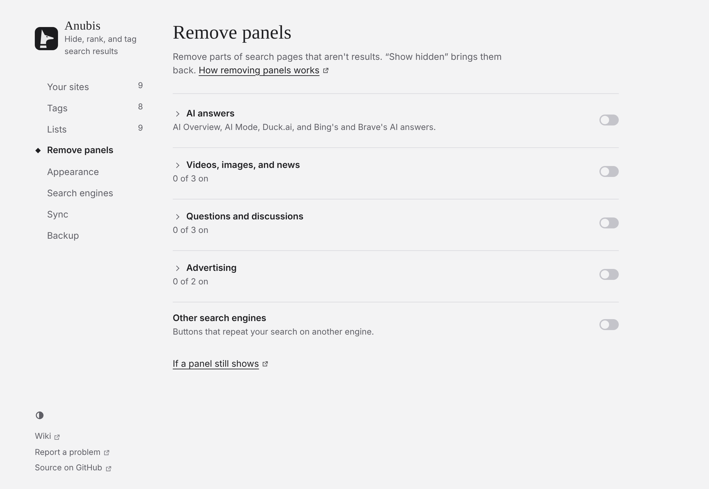

# Bereiche entfernen

**Einstellungen → Bereiche entfernen** nimmt die Teile, die du wählst, aus jeder Suchseite. Alle sind anfangs aus. Der Schalter einer Gruppe schaltet alle ihre Teile zusammen; drücke auf den Namen der Gruppe, um ihre Teile einzeln zu wählen.

<!-- Maintainer: German translation of docs/guide/clean-up.md. The screenshots are the English ones. -->

| Schalter | Entfernt |
| --- | --- |
| **KI-Antworten** | Googles „Übersicht mit KI“ und den KI-Modus, Duck.ai und die KI-Antworten von Bing und Brave. |
| **Videobereiche** | Bereiche mit Videos und Kurzvideos. |
| **Ähnliche Fragen** | Aufklappbare Fragenlisten. |
| **Diskussionsbereiche** | Forenbereiche. Forenergebnisse bleiben. |
| **Top-Meldungen** | Nachrichtenbereiche. |
| **Bilderzeilen** | Reihen von Bildern. |
| **Ähnliche Suchanfragen** | „Ähnliche Suchanfragen“ und „Andere suchten auch nach“. |
| **Andere Suchmaschinen** | Schaltflächen, die deine Suche anderswo wiederholen. |
| **Ads** | Gesponserte Ergebnisse und Produktkarussells. |
| **Bitten, Werbung zuzulassen** | Banner, die dich bitten, Werbung zuzulassen. |

## Was entfernt wurde

Die Zusammenfassung sagt, was weg ist. **Ausgeblendete zeigen** bringt es zurück, umrandet.

## Wie Bereiche erkannt werden

An ihren Überschriften, auf Englisch, Französisch, Deutsch, Spanisch, Portugiesisch, Italienisch und Niederländisch. Wenn einer in deiner Sprache nicht entfernt wird, [eröffne ein Issue](https://github.com/Bishop-V/anubis/issues) mit seiner Überschrift.

## KI-Antworten an der Quelle verhindern

Bei Google öffnet **Immer den Tab „Web“ öffnen** Googles schlichte Liste von Links, ohne KI und ohne Bereiche. Wähle **Alle** über den Ergebnissen für die gewohnte Seite.
