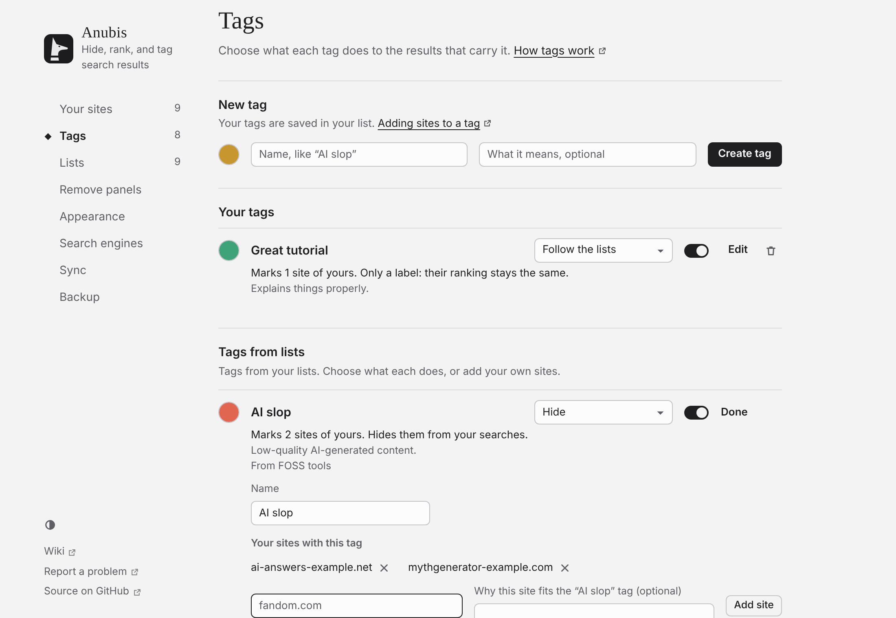

# Tags

Tags sind Beschriftungen unter dem Titel eines Ergebnisses, etwa „Official docs“ oder „Paywalled“. Sie kommen aus deinen Listen und von dir, und du entscheidest, was jedes bewirkt.

<!-- Maintainer: German translation of docs/guide/tags.md. The screenshots are the English ones. -->

## Websites selbst mit Tags versehen

- **Auf jeder Website:** Öffne das Pop-up der Symbolleiste und drücke ein Tag unter **Tags**, oder gib ein **Neues Tag** ein.
- **Auf einer Suchseite:** Öffne das Menü eines Ergebnisses und drücke **+ Tag**.
- **Unter Einstellungen → Tags:** Drücke **Bearbeiten** an einem Tag, um es umzubenennen, Websites hinzuzufügen oder zu entfernen und zu notieren, warum jede Website passt.

Tags, die du einer Website gegeben hast, sind fett und unterstrichen. Tags aus einer Liste nennen die Liste, und nur diese Liste kann sie entfernen.

Um Tags in deine eigene Reihenfolge zu bringen, ziehe sie in **Einstellungen → Tags** an den Punkten, oder setze den Fokus auf die Punkte und drücke die Pfeiltasten nach oben und unten. Das Popup und das Ergebnismenü folgen dieser Reihenfolge.

## Entscheiden, was ein Tag bewirkt

Listen entscheiden, welche Websites ein Tag bekommen. Du entscheidest unter **Einstellungen → Tags**, was das Tag bewirkt:

| Auswahl | Ergebnisse mit dem Tag |
| --- | --- |
| **Den Listen folgen** | Tun, was die Liste sagt (Standard). Die meisten Listen beschriften nur. |
| **Nur Beschriftung** | Behalten ihren Platz. |
| **Hervorheben** | Bekommen einen blassen Hintergrund in der Farbe des Tags. |
| **Anheften** | Kommen ganz nach oben. |
| **Aufwerten** / **Abwerten** | Rücken fünf Plätze nach oben oder unten. |
| **Ausblenden** | Werden ausgeblendet. |

Schalte **Gezeigt** aus, damit ein Tag ohne seine Beschriftung wirkt.

### Sehen, was ein Tag mit einem Ergebnis macht

Ein Tag, das ein Ergebnis verschiebt oder ausblendet, zeigt statt seiner Raute eine Stecknadel, einen Pfeil oder ein durchgestrichenes Auge.

### Mehrere Tags an einem Ergebnis

Jedes Tag auf Aufwerten schiebt ein Ergebnis fünf Plätze nach oben, jedes auf Abwerten fünf nach unten, sodass sie sich addieren oder aufheben. Ein Tag auf Ausblenden blendet immer aus, außer du hast die Website selbst eingestuft. Das Menü des Ergebnisses sagt, welche Listen und Tags es verschoben haben.

## Nur ein Tag zeigen

Drücke ein Tag unter einem Ergebnis, um nur die Ergebnisse mit diesem Tag zu zeigen. Drücke es noch einmal, oder **Alle zeigen** in der Zusammenfassung, um zurückzugehen. Das Pop-up der Symbolleiste hat dieselben Tags unter **Diese Seite**.

## Wem gehört das Tag

Einer Liste gehören die Namen und Farben ihrer Tags und die Websites, die sie markiert. Dir gehören deine Websites. Deine Umbenennungen und Farben stehen über denen der Liste, und keine Seite überschreibt die andere. Wenn eine Liste ein Tag fallen lässt, das du verwendest, wandert es zu **Deine Tags**.

Listen mit derselben Tag-ID, etwa `paywall`, teilen sich ein Tag. Siehe [das Listenformat](../../list-format.md#tags) (auf Englisch).
