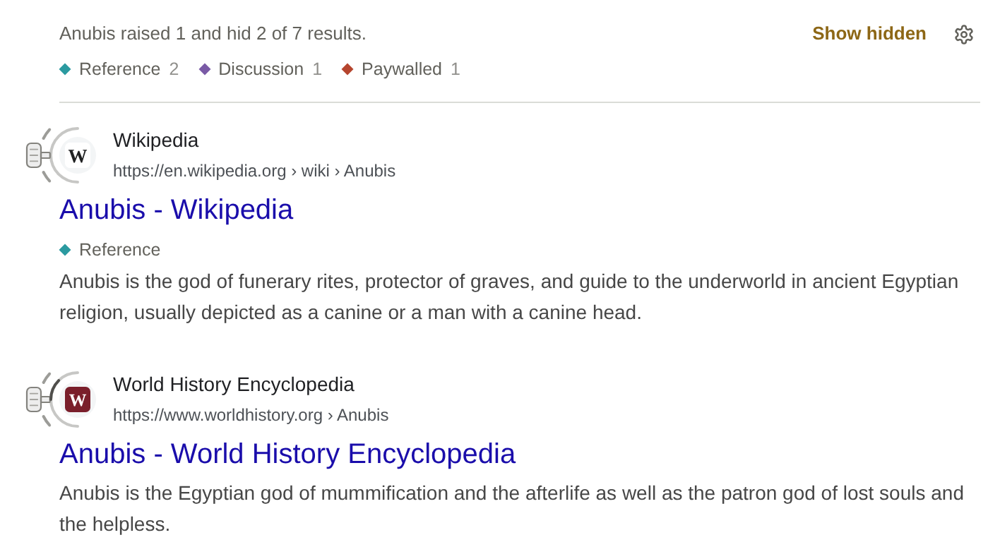
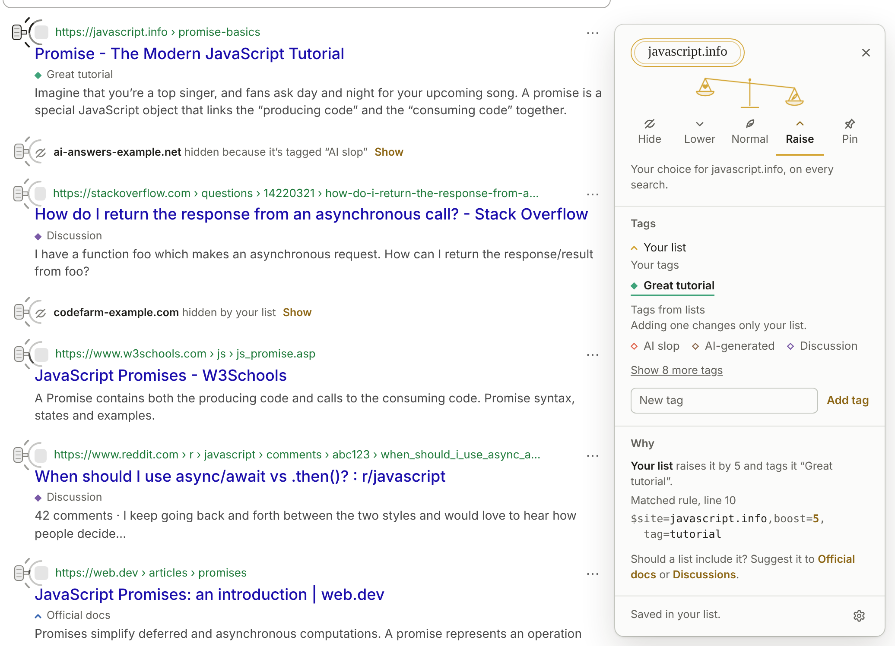
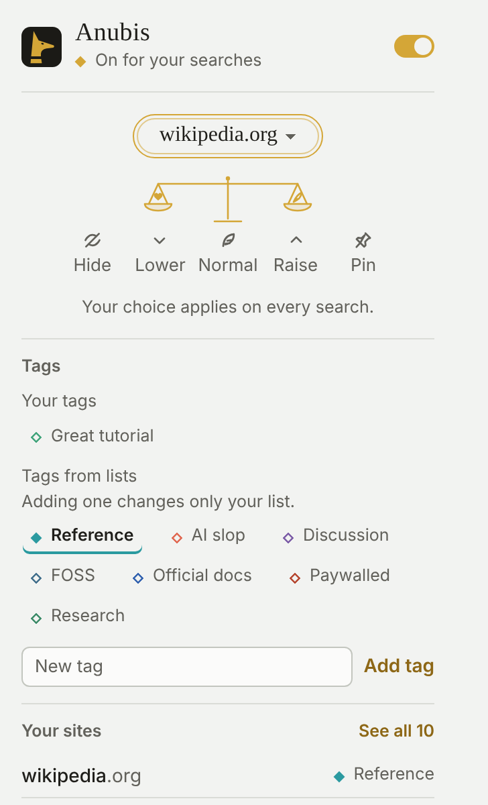

# Bắt đầu

::: warning Ngôn ngữ
Anubis hiển thị bằng ngôn ngữ của trình duyệt khi có bản dịch. Chỉ tiếng Anh được hỗ trợ đầy đủ: các bản tiếng Ả Rập, Bengal, Trung (giản thể), Trung (phồn thể), Pháp, Đức, Hindi, Indonesia, Ý, Nhật, Hàn, Bồ Đào Nha (Brazil), Nga, Tây Ban Nha, Thổ Nhĩ Kỳ, Urdu và Việt là bản dịch máy, nên hãy dùng cẩn thận. Để dùng Anubis bằng tiếng Anh, hãy đặt ngôn ngữ của trình duyệt là tiếng Anh. [Giúp dịch](./translate.md) nói thêm.
:::

## Cài đặt trên Firefox

Để cài đặt thông thường, hãy lấy [Anubis từ Firefox Add-ons](https://addons.mozilla.org/addon/anubis-search/). [Gói bản dựng Firefox](https://github.com/Bishop-V/anubis/releases/latest/download/anubis-firefox.zip) mới nhất và các gói có phiên bản cũng có trên [GitHub Releases](https://github.com/Bishop-V/anubis/releases).

## Cài đặt trên Firefox cho Android

Hỗ trợ Firefox cho Android còn ở mức thử nghiệm. Hãy lấy [Anubis từ Firefox Add-ons](https://addons.mozilla.org/addon/anubis-search/) trên điện thoại, trong Firefox. Anubis đọc được bố cục điện thoại của Google, DuckDuckGo và Bing; các công cụ tìm kiếm khác có thể chưa dùng được ở đó. Trên điện thoại, mỗi kết quả có một nút ⚖ ở cuối tiêu đề, và menu của nó trượt lên từ cuối màn hình. Firefox cho Android để các tiện ích trong menu thay vì thanh công cụ, nên hãy mở Anubis từ đó. Nếu có gì trông sai, hãy [báo cáo](https://github.com/Bishop-V/anubis/issues) kèm ảnh chụp màn hình.

## Cài đặt trên Chrome

Để cài đặt thông thường, hãy lấy [Anubis từ Chrome Web Store](https://chromewebstore.google.com/detail/aninblefigadaigfppckanjgiijcmmhi). [Gói bản dựng Chrome](https://github.com/Bishop-V/anubis/releases/latest/download/anubis-chrome.zip) mới nhất cũng có trên [GitHub Releases](https://github.com/Bishop-V/anubis/releases).

## Các trình duyệt khác

Hầu hết trình duyệt Chromium khác, như Brave, Vivaldi và Opera, cũng cài đặt được từ [Chrome Web Store](https://chromewebstore.google.com/detail/aninblefigadaigfppckanjgiijcmmhi). Trong Edge, hãy chọn **Cho phép tiện ích từ các cửa hàng khác** khi Chrome Web Store hỏi, rồi cài đặt từ đó. Anubis chưa có trên Edge Add-ons.

Để tải một gói theo cách thủ công, hãy tải xuống và giải nén [bản dựng Chrome mới nhất](https://github.com/Bishop-V/anubis/releases/latest/download/anubis-chrome.zip) từ GitHub Releases, hoặc tự dựng từ mã nguồn. Để dựng từ mã nguồn, bạn cần [Node.js](https://nodejs.org) 22.12 trở lên:

```sh
git clone https://github.com/Bishop-V/anubis.git
cd anubis
npm install
npm run build          # Firefox development build
npm run build:chrome   # for Chrome, Edge, and other Chromium browsers
```

Tải bản dựng phát triển hoặc gói đã giải nén vào trình duyệt của bạn:

- **Firefox:** mở `about:debugging`, chọn **This Firefox**, rồi **Load Temporary Add-on**, và chọn `.output/firefox-mv2/manifest.json`. Firefox gỡ các tiện ích tạm thời khi đóng.
- **Chrome:** mở `chrome://extensions`, bật **Developer mode**, chọn **Load unpacked**, và chọn `.output/chrome-mv3` hoặc gói phát hành đã giải nén.
- **Edge:** mở `edge://extensions`, bật **Developer mode**, chọn **Load unpacked**, và chọn `.output/chrome-mv3` hoặc gói phát hành đã giải nén.

Khi cài đặt xong, Anubis mở một thẻ chào mừng với các bước giữ nút của nó trên thanh công cụ của trình duyệt, một lần tìm kiếm để thử, và các danh sách bạn bắt đầu với.

Trình duyệt đặt các tiện ích mới sau nút Tiện ích (hình mảnh ghép) cạnh thanh địa chỉ. Để giữ nút của Anubis luôn hiện:

- **Chrome:** nhấn vào mảnh ghép, rồi nhấn vào chiếc ghim bên cạnh Anubis.
- **Edge:** nhấn vào mảnh ghép, rồi nhấn vào con mắt bên cạnh Anubis.
- **Firefox:** nhấn vào mảnh ghép, rồi nhấn vào bánh răng bên cạnh Anubis, và chọn **Ghim vào thanh công cụ**.

## Tìm kiếm như thường lệ

Hãy tìm kiếm trên bất kỳ [công cụ được hỗ trợ](./search-engines.md) nào. Anubis bắt đầu với các danh sách gắn nhãn tài liệu chính thức, thảo luận, trang tham khảo, tường phí, công cụ trực tuyến mã nguồn mở và phần mềm tự lưu trữ, cùng nội dung do AI tạo, và nâng các wiki độc lập lên trên các wiki Fandom mà chúng thay thế. Nhãn **AI slop** có sẵn cho các trang web bạn tự chọn để gắn nhãn.

Bản tóm tắt một dòng phía trên kết quả cho biết Anubis đã làm gì: nó đã nâng, hạ hoặc ẩn những kết quả nào, và trang có những nhãn nào. Trên điện thoại, bản tóm tắt chỉ nói ngắn gọn (“Anubis đã thay đổi 4 trên tổng số 9 kết quả.”), và **Chi tiết** hiện phần còn lại.

<!-- Maintainer: the screenshots on this page are the English ones, from mock pages. -->



## Ẩn một trang web

Mỗi kết quả có một vòng chỉ báo quanh biểu tượng của trang web: một nửa vòng tròn với một chiếc vương miện nhỏ ở bên trái. Nhấn vào vương miện, rồi trong menu, chọn **Ẩn**. Trên kết quả hình ảnh và video, vương miện nằm ở góc trên bên phải của ảnh. Trên điện thoại, hãy nhấn nút ⚖ ở cuối tiêu đề của kết quả, và menu trượt lên từ cuối màn hình.



Kết quả biến mất, và mọi kết quả từ trang web đó cũng sẽ biến mất trong mọi lần tìm kiếm. Bản tóm tắt phía trên kết quả luôn hiện, và ghi “Anubis giữ nguyên 10 kết quả” cho đến khi nó làm gì đó. Bản tóm tắt đếm những gì đã bị ẩn và ghi “Đã ẩn fandom.com.” cùng nút **Hoàn tác**, nút này đưa trang web về như cũ.

- **Hiện mục đã ẩn** trong bản tóm tắt hiện mọi kết quả đã ẩn trên trang, ở dạng mờ, cho đến khi bạn nhấn lại hoặc tìm kiếm thứ khác.
- Để ngừng ẩn trang web, hãy hiện nó ra, mở menu của nó và chọn **Bình thường**.
- Để chừa lại một dòng ở chỗ mỗi kết quả bị ẩn, hãy chọn **Thu gọn** trong **Cài đặt → Giao diện → Kết quả bị ẩn**:


Lựa chọn của bạn áp dụng cho cả trang web, gồm các tên miền phụ. Tên ở đầu menu cho phép chọn phạm vi trang web: `en.wikipedia.org` hay toàn bộ `wikipedia.org`.

## Xếp hạng trang web bạn đang xem

Nhấn biểu tượng Anubis trên thanh công cụ khi bạn đang ở bất kỳ trang web nào. Cửa sổ bật lên hiện tên trang web phía trên chiếc cân: hãy chọn thứ hạng cho kết quả của trang web đó trong các lần tìm kiếm sau, và thêm hoặc tạo nhãn trong **Nhãn**. Khi địa chỉ của trang web có nhiều hơn một phần, như `en.wikipedia.org`, hãy nhấn vào tên để chọn lựa chọn của bạn áp dụng cho phạm vi nào.

Trên trang tìm kiếm, cửa sổ bật lên thay vào đó cho biết Anubis đã làm gì với kết quả, cùng **Hiện mục đã ẩn**, **Tải thêm kết quả** và các nhãn của trang, để chỉ hiện những kết quả có một nhãn. Trên bất kỳ trang nào khác, **Thêm trang web** nhận tên một trang web và thứ hạng để gán cho nó.



## Tắt Anubis

Công tắc trong cửa sổ bật lên trên thanh công cụ tắt Anubis mà không cần gỡ cài đặt. Biểu tượng của nó chuyển sang màu xám, và các trang tìm kiếm được giữ nguyên.

## Phím tắt

- **Alt+Shift+O** bật hoặc tắt Anubis.
- **Alt+Shift+H** hiện các kết quả đã ẩn trên trang, và ẩn chúng lại.

Trên máy Mac, hãy nhấn Control thay cho Alt. Để đổi các phím này, hãy mở `chrome://extensions/shortcuts` trong Chrome, hoặc trong Firefox mở `about:addons`, nhấn nút bánh răng và chọn **Manage Extension Shortcuts**. Nếu một tiện ích khác đã dùng một trong các phím này, trình duyệt sẽ để trống phím tắt đó cho đến khi bạn chọn phím khác.

## Trợ giúp

**Trợ giúp** trong cửa sổ bật lên trên thanh công cụ mở wiki này. Trong **Cài đặt**, mỗi mục liên kết đến trang của nó ở đây, và **Wiki** ở cuối thanh bên mở trang đầu.

## Tiếp theo

- [Xếp hạng trang web](./ranking.md): Hạ, Nâng và Ghim làm gì.
- [Nhãn](./tags.md): gắn nhãn cho trang web và quyết định nhãn làm gì.
- [Đăng ký danh sách](./lists.md): để danh sách của người khác làm việc giúp bạn.
- [Gỡ khung](./clean-up.md): gỡ câu trả lời AI và các khung khác khỏi trang tìm kiếm.
