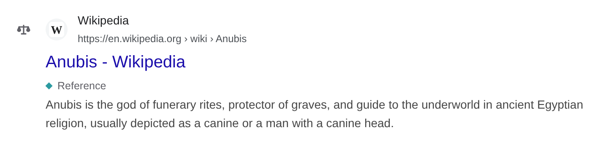
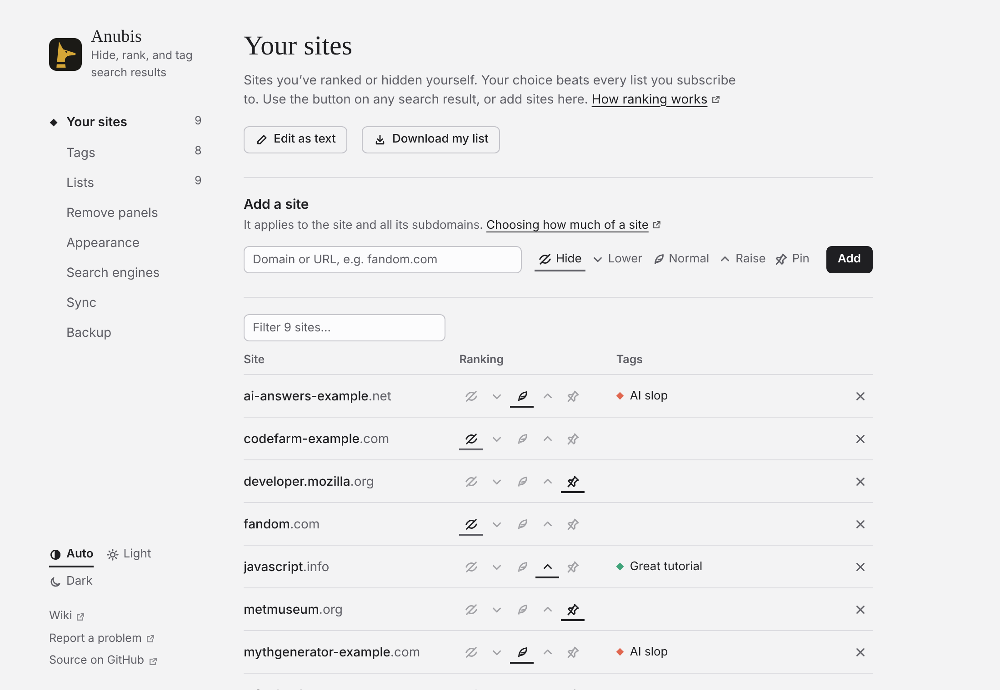

# Xếp hạng trang web

Mỗi trang web có một *thứ hạng*. Đặt nó từ nút bên cạnh bất kỳ kết quả nào, từ cửa sổ bật lên trên thanh công cụ, hoặc trong **Cài đặt → Trang web của bạn**.

<!-- Maintainer: Vietnamese translation of docs/guide/ranking.md. RankDemo (docs/.vitepress/theme/rank-demo.ts) draws a site being pinned and another lowered, and the picture below, for reading on GitHub, is hidden. The screenshots are the English ones. -->

<RankDemo />

Nút bên trái mỗi kết quả cho thấy thứ hạng của nó và mở menu. Trên hình ảnh và video, nút nằm ở góc trên bên phải; trên điện thoại, đó là nút ⚖ sau tiêu đề.

| Thứ hạng | Điều xảy ra |
| --- | --- |
| **Ẩn** | Các kết quả của trang web bị ẩn. |
| **Hạ** | Xuống năm bậc. Nhấn lần nữa để xuống mười, lần thứ ba để bỏ. |
| **Bình thường** | Xóa thứ hạng của bạn; nhãn và danh sách vẫn áp dụng. |
| **Nâng** | Lên năm bậc. Nhấn lần nữa để lên mười, lần thứ ba để bỏ. |
| **Ghim** | Lên đầu. |

Nâng và Hạ cộng thêm vào những gì danh sách và nhãn của bạn làm. Ghim và Ẩn được ưu tiên hơn chúng. **Hoàn tác** trong bản tóm tắt đảo ngược thay đổi gần nhất của bạn.

## Phạm vi trang web

Thứ hạng áp dụng cho trang web và các tên miền phụ của nó. Tên ở đầu menu chọn phạm vi, như `en.wikipedia.org` hay toàn bộ `wikipedia.org`. Lựa chọn cụ thể nhất được ưu tiên.

Trên Reddit, YouTube, Medium, GitHub và các trang tương tự, menu còn đưa ra phần thuộc về riêng một người, như `reddit.com/r/rust` hay `youtube.com/@name`, khi địa chỉ có nêu phần đó. Địa chỉ của một video YouTube không nêu kênh của nó, nên video được xếp hạng theo toàn bộ YouTube.

## Xếp hạng lại

Anubis chỉ sắp xếp lại các kết quả đã có trên trang. Để tới các trang sau, hãy dùng [Tải thêm kết quả](./more-results.md). Để giữ thứ tự của công cụ tìm kiếm, tắt **Cài đặt → Kết quả → Xếp hạng lại kết quả**.

## Kết quả bị ẩn

**Cài đặt → Giao diện → Kết quả bị ẩn** chọn cách chúng hiện ra:

- **Gỡ bỏ** (mặc định): biến mất, và được đếm trong bản tóm tắt.
- **Thu gọn**: một dòng với nút **Hiện**.
- **Làm mờ**: mờ đi tại chỗ.

## Trang web của bạn

**Cài đặt → Trang web của bạn** liệt kê mọi trang web bạn đã xếp hạng. Sửa chúng ở đó, từng cái một hoặc dưới dạng văn bản. Danh sách được đồng bộ với trình duyệt và có thể được [xuất bản](./publish-a-list.md).

