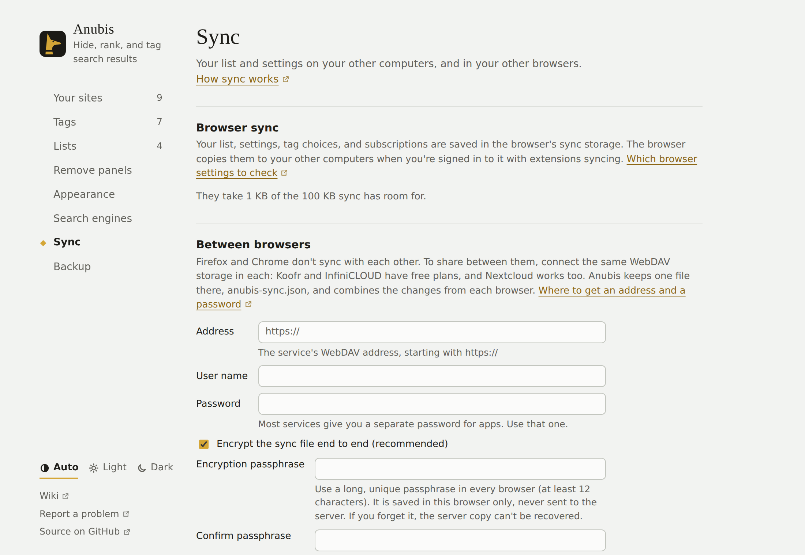

# Đồng bộ hóa giữa các máy tính

Anubis không có tài khoản hay máy chủ riêng. Nó lưu dữ liệu của bạn trong bộ nhớ đồng bộ hóa của trình duyệt, và trình duyệt sao chép chúng sang các máy tính khác của bạn. Để chia sẻ cả giữa Firefox và Chrome, bạn có thể kết nối một dịch vụ lưu trữ của riêng mình.

## Những gì được đồng bộ hóa

- **Danh sách của bạn**: mọi trang web bạn đã xếp hạng hoặc gắn nhãn
- **Cài đặt**
- **Lựa chọn nhãn**: mỗi nhãn làm gì, cùng tên và màu của nó
- **Lượt đăng ký**: bạn đăng ký những danh sách nào

Các danh sách bạn đăng ký không được sao chép giữa các máy tính. Mỗi máy tính tải bản sao riêng, từ cùng một địa chỉ.

## Đồng bộ hóa của trình duyệt

Tính năng này bật sẵn, không cần cài đặt gì trong Anubis. Tuy nhiên, Anubis không thể biết đồng bộ hóa của trình duyệt có đang bật không. Nếu một thay đổi không hiện trên máy tính khác của bạn, hãy kiểm tra các cài đặt này trên cả hai máy.

- **Firefox:** đăng nhập Firefox bằng tài khoản Mozilla. Trong cài đặt của Firefox, mục **Đồng bộ**, hãy chắc chắn **Tiện ích** được đánh dấu: điều này cũng đồng bộ dữ liệu của các tiện ích. Firefox đồng bộ khoảng mỗi 10 phút. Để đồng bộ ngay, hãy chọn **Đồng bộ ngay** ở cùng chỗ.
- **Chrome:** đăng nhập Chrome với đồng bộ hóa đang bật, và giữ **Tiện ích** trong những thứ nó đồng bộ (cài đặt của Chrome, mục **Bạn và Google**).

Đồng bộ hóa của trình duyệt chỉ đến được cùng loại trình duyệt trên các máy tính khác của bạn. Firefox và Chrome không đồng bộ với nhau, và Firefox cho Android hoàn toàn không đồng bộ dữ liệu tiện ích.

## Giữa các trình duyệt

Để chia sẻ giữa Firefox và Chrome, hoặc với Firefox cho Android, hãy kết nối cùng một nơi lưu trữ trong mỗi trình duyệt. Đây là tùy chọn, và không có gì thay đổi cho đến khi bạn kết nối. Anubis dùng được với mọi dịch vụ lưu trữ cung cấp **WebDAV**, một cách chuẩn để các ứng dụng lưu tệp ở đó. Anubis giữ một tệp ở đó, `anubis-sync.json`.

### Lấy địa chỉ và mật khẩu

Bạn cần ba thứ từ dịch vụ: địa chỉ WebDAV của nó, tên người dùng của bạn và một mật khẩu dành cho ứng dụng. Hầu hết dịch vụ không chấp nhận mật khẩu thông thường của bạn ở đây. Thay vào đó, chúng cho bạn tạo một mật khẩu riêng cho mỗi ứng dụng, và bạn có thể thu hồi mà không phải đổi mật khẩu của mình.

| Dịch vụ | Địa chỉ | Mật khẩu |
| --- | --- | --- |
| **Koofr** (miễn phí 10 GB) | `https://app.koofr.net/dav/Koofr` | Trong Koofr, **Preferences → Password → App passwords**: tạo một mật khẩu. Tên người dùng của bạn là địa chỉ email. |
| **InfiniCLOUD** (miễn phí 20 GB) | Hiện trên trang tài khoản của bạn, mục **Apps Connection**, sau khi bạn bật nó | Cùng trang đó hiện tên người dùng và mật khẩu cho ứng dụng. |
| **Nextcloud** | `https://your-server/remote.php/dav/files/your-user-name/` | **Settings → Security → Devices & sessions**: tạo một mật khẩu ứng dụng. |

Các dịch vụ khác và máy chủ của riêng bạn cũng dùng được, nếu chúng cung cấp WebDAV qua `https://`. Thư mục nào cũng được: hãy đưa địa chỉ của nó, và Anubis đặt tệp ở đó. Một địa chỉ kết thúc bằng `.json` được dùng làm chính tệp đó.

### Kết nối

<!-- Maintainer: Vietnamese translation of docs/guide/sync.md. The screenshot is the English one, from the mock Settings page. -->

1. Mở **Cài đặt → Đồng bộ hóa**, và trong **Giữa các trình duyệt** nhập địa chỉ, tên người dùng và mật khẩu.
2. Giữ bật **Mã hóa tệp đồng bộ hóa đầu cuối**, và chọn một cụm mật khẩu dài, duy nhất, tối thiểu 12 ký tự. Hãy dùng cùng cụm mật khẩu ở mọi trình duyệt. Anubis lưu nó trong bộ nhớ tiện ích cục bộ của trình duyệt đó để đồng bộ hóa nền có thể chạy; nó không bao giờ được gửi đến máy chủ hay được đồng bộ hóa của trình duyệt sao chép. Đừng dùng mật khẩu đăng nhập WebDAV của bạn.
3. Nhấn **Kết nối**. Trình duyệt hỏi bạn có cho phép Anubis truy cập máy chủ đó không. Firefox cũng hỏi liệu Anubis có được gửi danh sách của bạn đến đó không.
4. Làm tương tự trong trình duyệt khác với cùng cụm mật khẩu mã hóa.

**Cài đặt → Đồng bộ hóa** sau đó cho biết lần đồng bộ hóa gần nhất của Anubis, hoặc điều gì đã sai. **Đồng bộ hóa ngay** đồng bộ hóa lập tức.

### Vì sao chọn mã hóa này

Anubis dùng **AES-256-GCM**, một chế độ mã hóa có xác thực được hỗ trợ rộng rãi, tích hợp sẵn trong API Web Crypto của trình duyệt. AES mã hóa tệp đồng bộ hóa; GCM còn kiểm tra rằng bản mã không bị sửa đổi, và dùng một giá trị nonce ngẫu nhiên mới cho mỗi lần ghi. Khóa 256 bit được tạo ra từ cụm mật khẩu của bạn bằng **PBKDF2-SHA-256** và một salt ngẫu nhiên, nên Anubis không gửi hay lưu một tệp khóa riêng. Dùng mật mã học có sẵn của trình duyệt giúp tránh phải đóng kèm một thư viện mật mã của bên thứ ba.

Điều này bảo vệ nội dung của tệp, không bảo vệ việc bạn kết nối với máy chủ. Người vận hành máy chủ vẫn thấy được siêu dữ liệu kết nối và có thể xóa hoặc thay tệp; mã hóa không ngăn được việc giữ lại hoặc phát lại một bản mã hóa cũ hơn. Nếu bạn quên cụm mật khẩu, bản trên máy chủ không thể khôi phục; dữ liệu của bạn trong mỗi trình duyệt vẫn còn. Hãy chọn một cụm mật khẩu dài, duy nhất và giữ một bản sao lưu riêng.

Anubis giữ cụm mật khẩu trong bộ nhớ tiện ích cục bộ của trình duyệt đó để đồng bộ hóa tự động. Nó không được bảo vệ trước người có thể truy cập hồ sơ trình duyệt của bạn hoặc chạy mã với danh nghĩa bạn. Thông tin đăng nhập WebDAV cũng được lưu cục bộ và gửi đến máy chủ để đăng nhập.

### Đổi cụm mật khẩu

Trong **Cài đặt → Đồng bộ hóa**, hãy dùng **Đổi cụm mật khẩu mã hóa**. Nhập và xác nhận một cụm mật khẩu mới có ít nhất 12 ký tự. Trước hết Anubis kiểm tra cụm mật khẩu hiện tại có giải mã được tệp trên máy chủ không, rồi chỉ thay tệp nếu máy chủ xác nhận không ai đã thay đổi nó trong lúc đó. Nếu bước kiểm tra hoặc ghi thất bại, Anubis giữ cụm mật khẩu hiện tại và không ghi đè tệp. Hãy đồng bộ hóa trước rồi thử lại nếu tệp đã thay đổi trong lúc thao tác.

Nếu kết nối bị ngắt trong lúc máy chủ lưu tệp mới, Anubis đọc lại tệp. Khi cụm mật khẩu mới mở được tệp, Anubis lưu cụm mật khẩu mới. Khi Anubis không thể kết nối máy chủ để kiểm tra, nó giữ cụm mật khẩu cũ và cho bạn biết. Nếu lần đồng bộ hóa tiếp theo báo sai cụm mật khẩu, hãy nhập cụm mật khẩu mới.

Sau khi đổi thành công, hãy nhập cụm mật khẩu mới ở mọi trình duyệt khác trước khi nó đồng bộ hóa. Một trình duyệt vẫn dùng cụm mật khẩu cũ không thể đọc hay thay đổi tệp đã mã hóa; nó sẽ báo lỗi cụm mật khẩu và để nguyên tệp.

Các kết nối mới dùng mã hóa theo mặc định. Để tắt, hãy bỏ chọn tùy chọn khi kết nối; khi đó người vận hành máy chủ sẽ đọc được tệp. Các kết nối hiện có vẫn không mã hóa cho đến khi bạn nhập và xác nhận cụm mật khẩu trong Cài đặt → Đồng bộ hóa và chọn **Lưu cụm mật khẩu và đồng bộ hóa**. Một tệp đã mã hóa yêu cầu cụm mật khẩu ở mọi trình duyệt; Anubis sẽ không ghi đè nó nếu thiếu hoặc sai cụm mật khẩu. Bản sao lưu thuần túy xuất từ Cài đặt không được mã hóa bởi tính năng này.

### Khi nào nó đồng bộ hóa

- Vài giây sau khi bạn thay đổi gì đó
- Khi trình duyệt khởi động
- Khi bạn tìm kiếm, tối đa mỗi 5 phút một lần

### Thay đổi từ cả hai trình duyệt

Anubis kết hợp các thay đổi từ mỗi trình duyệt, nên không mất gì khi bạn dùng cả hai:

- Một trang web bạn ẩn trong Firefox và một trang bạn gắn nhãn trong Chrome đều được giữ.
- Nếu bạn nâng một trang web ở trình duyệt này và gắn nhãn cho nó ở trình duyệt kia, kết quả là nó vừa được nâng vừa có nhãn.
- Nếu cả hai trình duyệt thay đổi cùng một thứ trước khi đồng bộ hóa, như thứ hạng của cùng một trang web hoặc cùng một cài đặt, trình duyệt đồng bộ hóa sau cùng thắng.

Lần đầu một trình duyệt kết nối, nó lấy mọi thứ từ tệp. Các trang web và cài đặt bạn đã thay đổi trong trình duyệt đó trước khi kết nối cũng được giữ, trừ khi tệp đã thay đổi chính những mục đó.

### Ngắt kết nối

**Ngắt kết nối** trong **Cài đặt → Đồng bộ hóa** dừng đồng bộ hóa ở trình duyệt đó. Danh sách và cài đặt của bạn vẫn ở trong trình duyệt, và tệp vẫn ở trên máy chủ. Hãy xóa tệp ở đó nếu bạn muốn bỏ nó.

## Giới hạn

- **Kích thước:** đồng bộ hóa của trình duyệt chứa khoảng 100 KB cho mỗi tiện ích. Anubis nén danh sách của bạn trước khi lưu, nên vừa khoảng 10.000 trang web. **Cài đặt → Đồng bộ hóa** cho thấy chúng chiếm bao nhiêu chỗ. Nếu danh sách của bạn vượt quá, đồng bộ hóa của trình duyệt chỉ giữ nó trên máy tính đó và Cài đặt cho biết như vậy; cài đặt, lựa chọn nhãn và lượt đăng ký vẫn được đồng bộ hóa. Đồng bộ hóa qua máy chủ không có giới hạn này.
- **Các danh sách từ máy chủ khác:** nếu bạn đăng ký một danh sách không nằm trên GitHub, mỗi trình duyệt sẽ xin phép để tải nó. Sau khi đồng bộ hóa, hãy nhấn nút **Cập nhật ngay** (↻) của danh sách đó trong **Cài đặt → Danh sách** ở trình duyệt kia để cho phép ở đó.
- **Chỉ chuyển một lần:** bạn cũng có thể [xuất bản sao lưu](./import-and-backup.md) và khôi phục nó trong trình duyệt kia. Tệp đồng bộ hóa có cùng định dạng, nên **Khôi phục bản sao lưu** cũng đọc được nó.

## Quyền riêng tư

Đồng bộ hóa của trình duyệt đi qua tài khoản trình duyệt của bạn, giống như dấu trang. Anubis không bao giờ thấy nó.

Khi bạn kết nối một máy chủ, danh sách, cài đặt, lựa chọn nhãn và lượt đăng ký của bạn đi đến máy chủ đó và không đâu khác. Khi bật mã hóa đầu cuối, máy chủ không đọc được tệp đồng bộ hóa; khi không bật, người vận hành máy chủ đọc được. Tên người dùng và mật khẩu WebDAV của bạn được lưu trong trình duyệt đó, gửi đến máy chủ để đăng nhập, và không bao giờ được đưa vào đồng bộ hóa của trình duyệt hay tệp đồng bộ hóa. Cụm mật khẩu mã hóa được lưu cục bộ trong mỗi trình duyệt nơi bạn đặt nó, và không bao giờ được gửi đến máy chủ. Xem [Quyền riêng tư và quyền hạn](./privacy.md).
