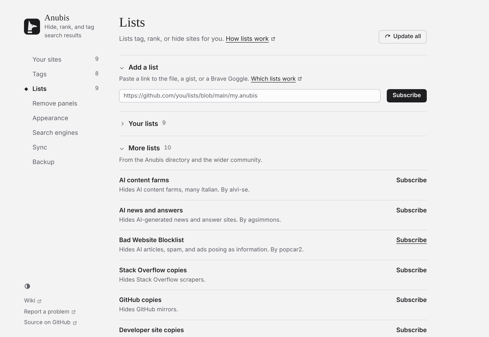

# 訂閱清單

清單會替你為網站加標籤、提升、降低或隱藏它們。任何人都能發布清單：它是 Git 儲存庫、gist 或任何公開網址上的一個文字檔案。中間沒有 Anubis 的伺服器。

Anubis 初始訂閱了隨它一起提供的五個小清單：**Official docs**、**Discussions**、**Reference**、**Paywalls** 和 **FOSS tools**。它們主要是新增標籤。**FOSS tools** 把 LibreSpeed 和 cobalt.tools 標為 FOSS，並讓 **AI slop** 標籤可供你自己選擇要標記的網站使用。

它還初始帶有兩個根據其他專案生成的清單（見下方），它們會在安裝時下載：**AI content** 和 **Independent wikis**。在這兩個清單出現之前安裝的 Anubis 副本，會在更新時訂閱它們，並一次性重新開啟所有初始清單。你可以在**設定 → 清單**中再次關閉其中任何一個。

<!-- Maintainer: Simplified Chinese translation of docs/guide/lists.md. The screenshot is the English one, from the mock Settings page. -->

## 訂閱

- **從目錄：** **設定 → 清單 → 更多清單**會顯示其他人已發布的清單。點選其中一個的**訂閱**。目錄會略過你已有的清單，以及與你已有的某個清單來自同一來源的清單。
- **從網頁：** [清單目錄](../../lists.md)頁面（英文）上的 **Subscribe**，或某個清單自己頁面上的訂閱連結，會開啟 Anubis 的設定，並填好該清單。請確認它是你想要的清單，然後在那裡點選**訂閱**來新增它。
- **透過地址：** 把清單的地址貼上到**新增清單**中，然後點選**訂閱**。指向 GitHub、GitLab 或 Codeberg 上某個檔案頁面的連結、gist 連結和 Brave Search Goggle 連結都可以；Anubis 會找到原始檔案。

託管在 GitHub 或 gist 上的清單會立即下載。對於託管在其他地方的清單，你的瀏覽器會詢問是否允許 Anubis 讀取那一個網站。

## 哪些清單可用

- Anubis 清單（`.anubis` 檔案）
- [Brave Goggles](https://github.com/brave/goggles-quickstart)
- [uBlacklist](https://github.com/iorate/ublacklist) 規則集
- 純網域清單（每行一個）和 hosts 檔案

Anubis 會自己識別格式。它無法使用的規則，如 uBlacklist 的標題表示式，會被跳過，並在設定中清單下方計數。

::: warning 濾鏡
有些 Brave Goggle 是*濾鏡*：它們會隱藏所有它們沒有提到的結果，所以一次搜尋只會顯示清單上的網站。Anubis 會用“濾鏡”標出這些清單，免得你不小心訂閱了一個。
:::

## 更新

Anubis 會在瀏覽器啟動時以及你搜尋時檢查你的清單是否有新版本，最多每 30 分鐘一次。每個清單會說明它希望多久被檢查一次（通常是每天一次）。**設定 → 清單**中的**全部更新**會立即檢查。

## 根據其他專案生成的清單

目錄中的一些清單，是根據其他專案收集的資料生成的。每週，Anubis 都會把這些資料轉換成清單併發布，所以它在 Anubis 兩次發布之間也保持最新。每個清單都會在**設定 → 清單**中註明它的來源並連結到來源。

| 清單 | 生成自 | 它的作用 |
| --- | --- | --- |
| **AI content** | laylavish 的 [HUGE AI Blocklist](https://github.com/laylavish/uBlockOrigin-HUGE-AI-Blocklist)（CC0） | 把主要由 AI 生成的文字或圖片構成的網站標為 **AI-generated**，把混合了真實作品和 AI 生成作品的網站標為 **Some AI content**。被該遮蔽清單歸為內容農場或垃圾內容的網站也會被標為 **AI slop**。除非你為某個標籤選擇了這樣做，否則它絕不會移動或隱藏任何內容。 |
| **Official docs (DevDocs)** | 其貢獻者的 [DevDocs](https://github.com/freeCodeCamp/devdocs)（MPL-2.0） | 把 DevDocs 收錄的文件網站標為 **Official docs**，並略微提升它們，和 Official docs 清單一樣。它涵蓋約 210 個網站，其中有 MDN 以及 Python、Rust 和 React 的文件。 |
| **Self-hosted FOSS** | 其貢獻者的 [awesome-selfhosted](https://github.com/awesome-selfhosted/awesome-selfhosted-data)（CC BY-SA 3.0） | 把約 1,000 個可以自己執行的自由軟體的網站標為 **FOSS**，與 FOSS tools 清單的標籤相同。採用非自由許可證的軟體不包括在內。它絕不會移動或隱藏任何內容。 |
| **Independent wikis** | Kevin Payravi 的 [Indie Wiki Buddy](https://github.com/KevinPayravi/indie-wiki-buddy)（MIT） | 提升獨立 wiki，標為 **Independent wiki**，並降低它們所取代的 Fandom、Fextralife 和 Neoseeker wiki，標為 **Has independent wiki**。 |

若要在這些清單中新增某個網站，或讓某個網站被移除，請透過上面的連結向它所來自的專案貢獻。Anubis 會原樣複製資料，下一次每週更新就會帶來這項更改。結果選單中的**有誤？報告**會在該專案的問題追蹤器上開啟一個 issue。

若要不再使用其中一個，請像對待任何清單一樣取消訂閱或關閉它。若要保留某個清單但不要它的某個標記，請在**設定 → 標籤**中關閉該標籤，或在那裡選擇它的作用。

## 關閉或取消訂閱

**你訂閱的清單**中的每個清單都有一個開關，可暫時關閉它，還有一個取消訂閱的按鈕。取消訂閱立即生效，訊息旁邊有**復原**按鈕，持續幾秒鐘。你自己設的排名永遠優先於任何清單，所以若要就某個網站推翻某個清單，請自己為該網站排名。

## 報告清單中的錯誤

如果某個清單錯誤地隱藏、排名或標記了某個網站，請開啟結果的選單。在**原因**下，“有誤？報告給 *清單名稱*”會在該清單的問題追蹤器上開啟一個預先填好的 issue，其中有匹配的規則和結果的地址。寫明應該改什麼，然後提交。在你自己提交之前，不會傳送任何內容。

這適用於發布在 GitHub、GitLab 或 Codeberg 儲存庫中的清單，以及說明了自己的問題追蹤器的清單。若要立即推翻某個清單，請自己為該網站排名；報告則能讓清單為所有人得到修正。

## 向清單推薦網站

在你自己為某個網站排過名或加過標籤之後，結果的選單會對接受推薦、且尚未提到該網站的清單，提供“推薦給 *清單名稱*”。它會在 GitHub、GitLab 或 Codeberg 上開啟一個預先填好的 issue，供你檢查並提交。在你自己提交之前，不會傳送任何內容。
